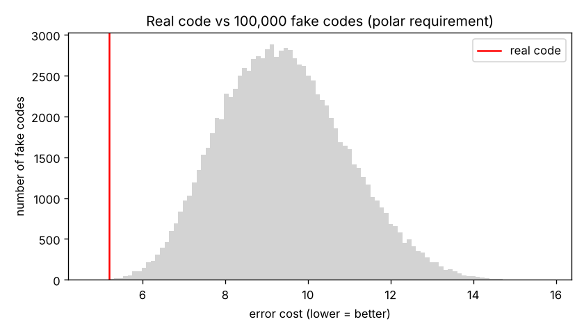
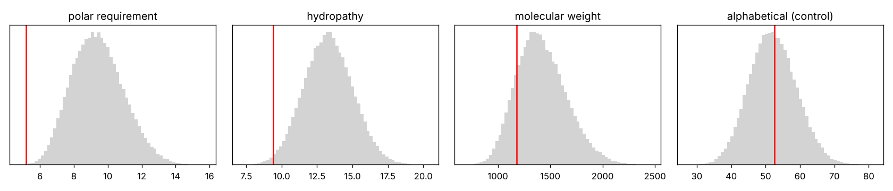
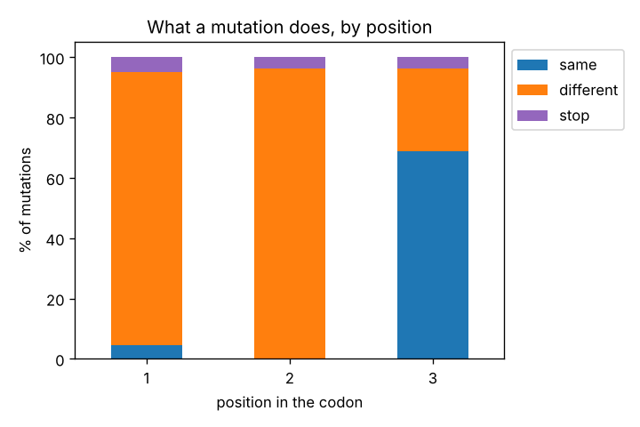
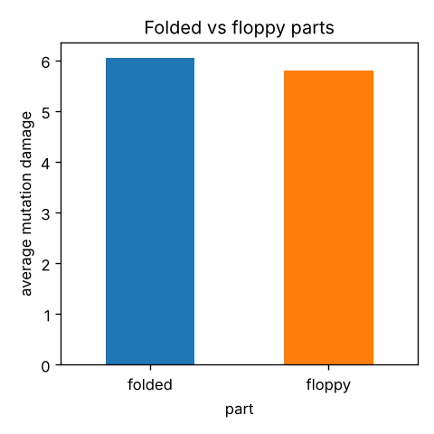

# codon-shuffle

**Is the genetic code special?**

All living things use (almost) the same genetic code to turn DNA into proteins: 64 codons → 20 amino acids + stop. We wanted to check if the way the code is arranged is special, or if any random arrangement would work just as well.

**Idea:** make 100,000 fake genetic codes, give each one a score for how much damage a single-letter DNA mutation does, and see where the real code ranks.

This is a reproduction of Haig & Hurst (1991), plus a small follow-up using AlphaFold.

## Why we made this

I (Manan) got really interested in genetics in Class 12, when we studied how DNA is read in codons and turned into proteins. We learned that the genetic code is "degenerate" (most amino acids have more than one codon) and almost universal, and that a single changed letter can change a protein.

That made me wonder whether the way the code is arranged has a reason, or whether it could just as well have been any other arrangement. When I started learning Python in college, I looked into it and found papers that had tested exactly this. Antara and I then decided to try reproducing their result ourselves, with me working on the biology and on the code with her as well.

## Results



Only **10 out of 100,000** fake codes did better than the real one (1 in 10,000), the same as Haig & Hurst found. Our score for the real code is 5.194, also the same as in the paper.

We also tried other amino acid properties:

| Property | % of fake codes better than the real one |
|---|---|
| Polar requirement (how much it likes water) | 0.010% |
| Hydropathy (another water scale) | 0.8% |
| Molecular weight | 15.6% |
| Alphabetical order (control, shouldn't matter) | 53.4% |



So the code isn't the best at everything. It's mostly good at keeping an amino acid's relationship with water the same after a mutation, which is important for how proteins fold. The alphabetical control is in the middle, which shows the method isn't biased.

Where the protection comes from: mutations in the 3rd letter of a codon usually don't change anything (69%), and the 2nd letter causes the biggest changes.



## Follow-up with AlphaFold (early look)

If the code protects how much an amino acid likes water, that should matter most in the **folded** parts of proteins. AlphaFold gives each amino acid a confidence score (pLDDT): above 70 usually means folded, below 50 usually means floppy (no fixed shape). We used 22 human proteins: the ones behind the genetic disorders and biotech examples from Class 12 (haemoglobin, factor VIII and IX, CFTR, PKU, colour blindness opsins, ADA, insulin...) plus some well-known proteins.



**Result: no clear difference yet.**

- Pooled together, folded parts were slightly *worse* protected (6.05 vs 5.81).
- But two proteins make up two-thirds of the floppy residues: factor VIII (its B domain really is disordered) and collagen. Collagen isn't really floppy: it's a triple helix, and AlphaFold predicted one chain alone, so it gets low confidence. Without collagen, folded parts come out slightly better protected (6.02 vs 6.13).
- Within proteins, 7 of 10 had better-protected amino acids in their folded part, but the differences are small and could be chance.
- Signal peptides (short tags at the start of secreted proteins) also get low pLDDT without being floppy.

So the main thing we learned here is that low pLDDT doesn't always mean "floppy".

## How this connects to Class 12

| Class 12 topic | Where it shows up |
|---|---|
| The genetic code (triplet, degenerate, universal, start/stop codons) | Notebook 01: the code table |
| Point mutations (e.g. sickle-cell anaemia) | Notebook 01: what one changed letter does |
| Mendelian disorders (haemophilia, sickle-cell, thalassemia, PKU, colour blindness, cystic fibrosis) | Notebook 03: the proteins we picked |
| Biotechnology (recombinant insulin, ADA gene therapy, transgenic animals) | Notebook 03: the proteins we picked |
| *Not in the syllabus:* why the code is arranged this way | Notebooks 02 and 03: testing it with simulations and AlphaFold |

## Authors

- **Manan Khurana** ([@Mkhurana3](https://github.com/Mkhurana3)), biology: came up with the question from Class 12 genetics, worked out the biology behind it (the genetic code, mutations, amino acid properties, protein folding), chose the proteins for the AlphaFold part, and interpreted the results.
- **Antara Bhattacharya** ([@antarahere](https://github.com/antarahere)), coding: worked on the Python side, i.e. the functions in `geneticcode.py` and `alphafold.py`, the tests, the 100,000-code simulation, the notebooks and the plots.

## Notebooks

1. `01_looking_at_the_code.ipynb`: the code table, what mutations do, the score for the real code
2. `02_random_codes.ipynb`: the 100,000 fake codes (takes about a minute)
3. `03_alphafold.ipynb`: uses AlphaFold's confidence score (pLDDT) to compare the folded and floppy parts of 22 human proteins (see below)

The functions are in `geneticcode.py` and `alphafold.py`.

## How to run

```bash
python -m venv .venv
source .venv/bin/activate        # Windows: .venv\Scripts\activate
pip install -r requirements.txt
pytest                           # runs the tests in tests/
jupyter notebook
```

## Limitations

- Our fake codes keep the same groups of codons as the real one. A different way of making fake codes would give different numbers.
- This shows the arrangement probably isn't an accident. It doesn't show *why* the code ended up like this.
- The AlphaFold part uses only 22 proteins, and pLDDT is a prediction, not a measurement.

## Ideas for later

- Redo notebook 03 without collagen and signal peptides, with many more proteins, and add a proper statistics test.
- Run the folded vs floppy comparison with the fake codes from notebook 02 too, to see if the real code gives a bigger difference than fake codes.
- Try more amino acid properties.

## References

Papers
- Haig D, Hurst LD (1991). A quantitative measure of error minimization in the genetic code. *J Mol Evol* 33:412-417.
- Freeland SJ, Hurst LD (1998). The genetic code is one in a million. *J Mol Evol* 47:238-248.
- Woese CR et al. (1966). The molecular basis for the genetic code. *PNAS* 55:966-974. (polar requirement values)
- Kyte J, Doolittle RF (1982). A simple method for displaying the hydropathic character of a protein. *J Mol Biol* 157:105-132. (hydropathy values)
- Jumper J et al. (2021). Highly accurate protein structure prediction with AlphaFold. *Nature* 596:583-589.

Books
- Alberts B et al. *Molecular Biology of the Cell*, 7th ed. W. W. Norton, 2022. (ch. 6: the genetic code and mutations)
- Nelson DL, Cox MM. *Lehninger Principles of Biochemistry*, 8th ed. Macmillan, 2021. (amino acids and protein structure)
- Downey AB. *Think Stats*, 3rd ed. O'Reilly, 2025. (testing ideas with simulation in Python)
- VanderPlas J. *Python Data Science Handbook*, 2nd ed. O'Reilly, 2022. (pandas and matplotlib)
